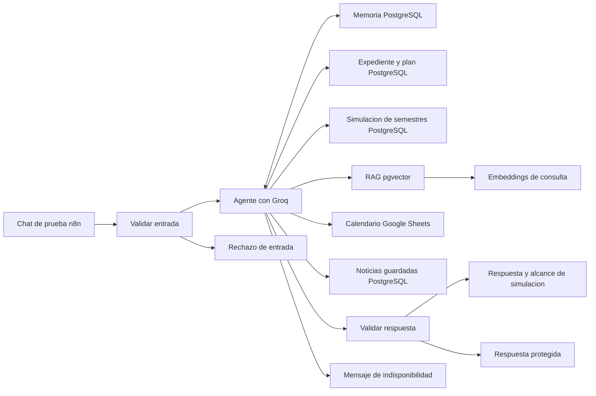

# Chatbot de apoyo academico de Ingenieria de Sistemas
Version del prototipo: 14 de noviembre de 2026.

## Objetivo y alcance
Asistir consultas de matricula, avance, historial, prerrequisitos, simulacion de periodos, competencias digitales, calendario y noticias. La logica conversacional y las integraciones se ejecutan en n8n Cloud. PostgreSQL y Google Sheets son fuentes externas. El modelo de lenguaje se consume en Groq; los embeddings usan Gateway de n8n.

El plan de 32 materias y 110 creditos, estudiantes DEMO001 a DEMO010, notas y calendario 2027-1 son ficticios. Los documentos del profesor son referencias; una propuesta no acredita normativa vigente. Las noticias UNAB son publicaciones reales y se distinguen del escenario academico ficticio.

## Arquitectura implementada

El agente selecciona herramientas por intencion. No hay un clasificador separado con un modelo adicional. La seleccion de herramientas ya proporciona el ruteo; puede solicitar mas de una para consultas combinadas. Se implementaron un cliente Android nativo y un servidor FastMCP propio como componentes locales; aun no estan conectados al despliegue real.

## Por que hay varios workflows
Existe un solo flujo conversacional. Los demas tienen ciclos distintos y se operan por separado:

| Workflow | Funcion | Cuando se ejecuta |
|---|---|---|
| Chatbot Academico | Todas las consultas del estudiante | Cada mensaje |
| Preparar Base Academica Demo | Crear tablas y datos sinteticos | Instalacion; no repetir sobre datos modificados |
| RAG Sistemas - Indexar documentos | Crear/reemplazar embeddings del corpus | Al instalar o cambiar documentos |
| Sistemas - Preparar proyeccion de semestres | Instalar funcion y ejecutar verificaciones SQL | Al instalar o cambiar algoritmo |
| Sistemas - Actualizar noticias UNAB | Descargar, extraer y guardar noticias sin duplicados | Publicado; manual y horario diario 08:00 America/Bogota |
| Sistemas - Preparar calendario DEMO | Carga inicial de eventos | Ya ejecutada; escritura desactivada |

Estan organizados en la carpeta n8n **Sistemas - Trabajo final**. Ejecutar la ingesta, el seed o el scraper con cada mensaje agregaria trabajo innecesario y riesgos de reescritura. Si se exigiera literalmente un solo archivo de workflow, esas ramas podrian convivir con disparadores distintos, pero seguirian siendo tareas separadas.

## Modelo de datos
Esquema relacional: academico_demo.
- estudiantes(codigo PK, nombre, programa, semestre_actual, es_sintetico).
- materias(codigo PK, nombre, semestre, creditos).
- prerrequisitos(materia, requisito): referencias a materias y clave compuesta.
- matriculas(estudiante, periodo, estado): clave compuesta.
- historial(estudiante, periodo, materia, nota, estado): referencias a matriculas/materias.
- noticias(wp_id PK, titulo, resumen, url unica, publicada_en, modificada_en, consultada_en).
- estado_fuentes(fuente PK, ultima_actualizacion_ok, observacion).
- v_resumen: promedio historico ponderado, matricula y creditos aprobados.
- v_materias_pendientes: materias sin aprobar y requisitos aun no cumplidos.

Almacenamiento adicional:
- public.rag_sistemas_vectores: contenido, metadata y embedding de 1536 dimensiones.
- n8n_chat_histories: historial de conversacion administrado por el nodo de memoria.

Las herramientas academicas ejecutan SQL fijo con parametros; el modelo no recibe una herramienta de SQL libre. La credencial PostgreSQL actual tiene permisos amplios: la restriccion de lectura es del diseño de herramientas, no una garantia de un usuario de base de datos de solo lectura. Antes de usar datos reales, separar roles de lectura, mantenimiento y memoria, y agregar autenticacion y autorizacion por estudiante. No se usan datos reales en este prototipo.

## Promedio, avance y recomendaciones
El promedio historico incluye los intentos reprobados y se pondera por creditos. Los creditos aprobados se cuentan una sola vez por materia. El avance es creditos aprobados / 110. Para DEMO001: promedio 3.5, 22 creditos aprobados y avance del 20%.

Consultar expediente solicita solo resumen, historial, pendientes o completo segun la pregunta para evitar enviar listas innecesarias al modelo. Las recomendaciones parten de prerrequisitos_cumplidos y distinguen materias en curso de nuevas candidatas. Aprobar se simula, nunca se da por hecho para la matricula real.

## Proyeccion
Funcion academico_demo.proyectar_semestres(codigo,18), estable y sin escrituras. Selecciona materias elegibles usando requisitos aprobados en periodos anteriores, prioriza en curso y respeta 18 creditos. Actualiza el conjunto simulado al finalizar cada periodo, evitando cursar simultaneamente una materia y su prerrequisito.

El resultado para DEMO001 es seis periodos simulados incluyendo el actual. Es un algoritmo voraz, no una solucion optima garantizada. Supone aprobar todo y oferta cada periodo, sin cupos ni conflictos de horario. No incluye requisitos externos al plan. La cota por creditos no sustituye la simulacion.

## RAG y procedencia
96 fragmentos: dos del manual demo, ocho del FAQ y 86 de la propuesta. Fragmentos de hasta 1200 caracteres con solapamiento de 180, separacion Markdown; embeddings text-embedding-3-small, 1536 dimensiones. Recuperacion por similitud coseno, tres resultados y filtro corpus=sistemas_v1. Una busqueda RAG por mensaje y memoria de dos interacciones para reducir el consumo de cuota.

Fuentes del profesor: repositorio https://github.com/adiacla/clima-Biing26-UCC-Ibague, commit 9a01d6d4779579c464115543008defb216ad703e.
Se usan FAQ_RAG_optimizados (1).md y Propuesta Competencias Digitales UNAB V11ADC_clean (1).md. No se cargaron registros climaticos. El nombre del repositorio no define el dominio del chatbot.

La respuesta debe parafrasear y citar titulo y URL de metadata. Los tres pilares descritos en la propuesta son Competencias Digitales Basicas, Analitica y Contenido Digital, y Tecnologias Transformativas. Una sola validacion no sustituye completar o validar los tres componentes. La recuperacion y las instrucciones reducen errores, pero no eliminan alucinaciones: una prueba detecto nombres imprecisos y se reforzaron las instrucciones; requiere revision humana para interpretar normativa.

## Calendario y noticias
La hoja privada Google Sheets contiene seis eventos ficticios del periodo 2027-1. El agente tiene solo la operacion read. Fechas de ejemplo: inscripcion 11-22 de enero de 2027; inicio de clases 25 de enero. No constituyen calendario oficial.

Hoja: https://docs.google.com/spreadsheets/d/1ett973VG0v2ZDECB9kYR8OO-T8kfz3pddtKPnYPidBE/edit

El scraper consume la API publica WordPress de UNAB, categoria 556 (Ingenieria de Sistemas), hasta 20 publicaciones. Extrae titulo y resumen del HTML, normaliza espacios y hace upsert por wp_id. Repetirlo no crea duplicados. La marca de ultima actualizacion solo se cambia al completar la carga. La consulta advierte si el cache supera 48 horas. El horario activo es 08:00 America/Bogota.

## Validacion y fallos
Entrada: expresiones regulares para claves con prefijos conocidos, contenido vacio y mas de 6000 caracteres. Salida: claves conocidas, contenido vacio y patrones script/javascript. No se transmite streaming antes de revisar la respuesta. Estas reglas no detectan todas las formas de secretos ni todas las inyecciones de instrucciones.

Un nodo de transformacion restaura chatInput y sessionId porque Guardrails entrega guardrailsInput y checks. La salida aprobada se transforma a output, el campo que consume el chat. Si se mencionan semestres, se agrega el alcance de la simulacion.

Groq tiene un limite observado de 8000 tokens/minuto para el modelo usado. Se compactaron instrucciones, se limito la salida a 1400 tokens y se evitan listas no solicitadas. El limite sigue existiendo. El nodo del modelo admite reintentos; si el agente falla se devuelve un mensaje de indisponibilidad, sin afirmar resultados inventados. Una ejecucion marcada success que termine en ese mensaje no prueba una respuesta academica correcta.

## Estado de entrega
Implementado: backend n8n, base sintetica, memoria, RAG, proyeccion, calendario, noticias, guardrails basicos, manejo de errores y respaldos.
FastMCP dispone de código y verificaciones locales, pendiente de conexión y activación. La aplicación móvil fue cancelada y eliminada; el alcance acordado es web de PC.
Web de PC instalada y conectada en http://100.74.216.15:8091/ por Tailscale. El usuario autorizo el endpoint demo publico de n8n. FastMCP y video están pendientes. La aplicación móvil está cancelada. Ver 19_SERVIDOR_ACTUAL.md y 20_DISENO_VIDRIO.md para el estado operativo y visual actual.

## Versión final web: Cloudflare e identificación
Portal: https://academico.nicolas16.life/. Cloudflare dirige el hostname al servicio existente en http://100.74.216.15:8091, sin abrir un puerto público del servidor. El servidor valida el hostname y el origen de las solicitudes; conserva límites de consultas y tamaño. El túnel existente se mantiene activo.

La web solicita U00 seguido de seis cifras. Una rama del flujo principal consulta PostgreSQL con parámetros y devuelve semestre, matrícula, promedio, créditos y avance. La sesión se vincula en el servidor al expediente validado. Cambiar estudiante borra mensajes visibles y renueva la sesión. Caducidad: dos horas. No es autenticación institucional y solo contiene datos sintéticos.

Total actual: 13 estudiantes, 32 materias y 110 créditos del plan simplificado. La migración 21 conserva las claves internas; 24 agrega tres perfiles sin sobrescribir los anteriores. Respaldos actuales: 05 y 14, también reunidos en 25. No volver a ejecutar la semilla inicial sobre la base existente.

Aplicación móvil cancelada y eliminada. Video aplazado. FastMCP continúa sin conexión real PostgreSQL ni servicio activo: requiere configurar una credencial de lectura directamente en el servidor antes de conectarlo a n8n. No declarar este componente como terminado.

## Cierre del 15 de noviembre de 2026
Credencial Bearer Auth validada por n8n. Cliente MCP habilitado y flujo principal publicado con 19 nodos. Plan y noticias se consultan por MCP; expediente y proyección conservan SQL vinculado al perfil. La ejecución 63 confirmó noticias vía MCP; la 64 confirmó el expediente personal. Consulta real por Cloudflare completada después de publicar. No queda pendiente la conexión MCP. Informe final disponible en Informe_final_Chatbot_Academico.pdf. Video aplazado; app móvil cancelada.
