# 🎓 ChatBot Académico — Ingeniería de Sistemas

Asistente conversacional que responde preguntas de un estudiante sobre **su propio expediente**: promedio, créditos, materias que puede matricular, cuántos semestres le faltan, fechas del calendario, documentos del programa y noticias de la universidad.

Las respuestas no se las inventa el modelo de lenguaje: **cada dato sale de una fuente consultable** (PostgreSQL, Google Sheets, documentos indexados o noticias sincronizadas) y el agente decide qué herramienta usar en cada pregunta.


> **Pruébalo:** https://academico.nicolas16.life/ con el código `U00100012`.
> **Video completo:** [▶ ver en el navegador](https://cdn.jsdelivr.net/gh/Nicolas1609-1/ChatBot@main/docs/video/demo-chatbot-academico.mp4) · **Informe técnico:** [Informe_final_Chatbot_Academico.pdf](Informe_final_Chatbot_Academico.pdf)

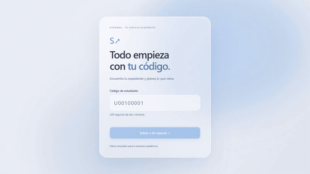

### 🎬 Video de demostración

[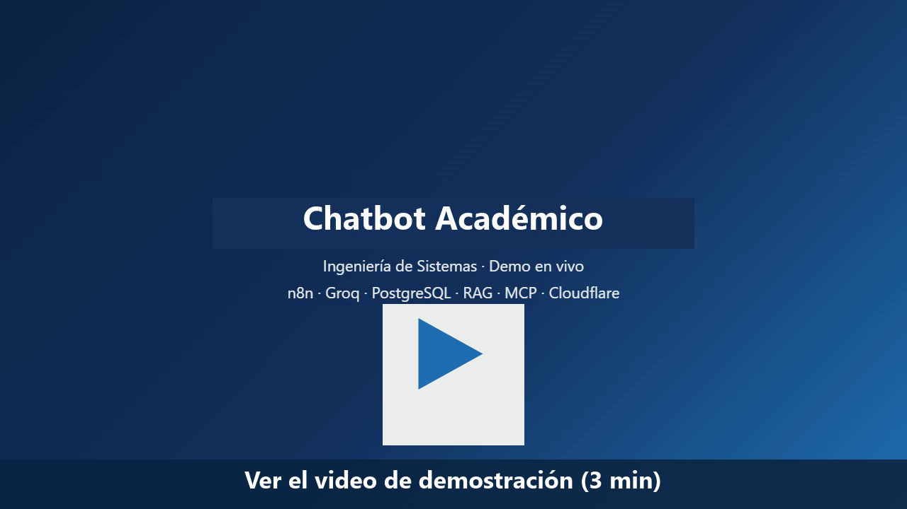](https://cdn.jsdelivr.net/gh/Nicolas1609-1/ChatBot@main/docs/video/demo-chatbot-academico.mp4)

Haz clic en la imagen para reproducirlo (3 min, sin audio, con subtítulos). Recorrido real por el portal con el estudiante Mateo: promedio, próximo semestre, proyección, calendario, documentos del profesor y noticias. Si prefieres descargarlo: [`docs/video/demo-chatbot-academico.mp4`](docs/video/demo-chatbot-academico.mp4).

> ⚠️ Todos los estudiantes, notas, el plan de 110 créditos y el calendario son **datos simulados** para el proyecto académico. Las noticias sí son publicaciones reales de la UNAB. El código U00 selecciona un perfil de prueba; **no es un inicio de sesión real**.

---

## Contenido

1. [Qué hace](#1-qué-hace)
2. [Pruébalo en un minuto](#2-pruébalo-en-un-minuto)
3. [Capturas](#3-capturas)
4. [Arquitectura](#4-arquitectura)
5. [Qué pasa cuando haces una pregunta](#5-qué-pasa-cuando-haces-una-pregunta)
6. [Las piezas, una por una](#6-las-piezas-una-por-una)
7. [Lecciones aprendidas](#7-lecciones-aprendidas-lo-que-salió-mal-y-cómo-se-corrigió)
8. [Cómo replicarlo](#8-cómo-replicarlo)
9. [Estructura del repositorio](#9-estructura-del-repositorio)
10. [Seguridad y límites](#10-seguridad-y-límites)

---

## 1. Qué hace

| Pregunta del estudiante | De dónde sale la respuesta |
|---|---|
| ¿Cuál es mi promedio, créditos y avance? | Vista SQL `v_resumen` en PostgreSQL |
| ¿Qué materias puedo matricular el próximo semestre? | Función SQL de proyección (respeta prerrequisitos y 18 créditos) |
| ¿Cuántos semestres me faltan? | Simulación semestre a semestre en PostgreSQL |
| ¿Cuándo son las inscripciones? | Hoja de Google Sheets (calendario) |
| ¿Qué son los pilares de competencias digitales? | RAG: documentos del profesor indexados con pgvector |
| ¿Qué noticias hay del programa? | Noticias reales de la UNAB, sincronizadas a diario y servidas por MCP |

Además: memoria de conversación, validación de entrada y salida (guardrails), mensajes de error controlados cuando el proveedor de IA llega a su límite, y dos interfaces (web y móvil) sobre el mismo backend.

## 2. Pruébalo en un minuto

1. Abre **https://academico.nicolas16.life/**
2. Escribe un código de prueba y entra:

| Código | Estudiante | Semestre | Promedio | Créditos aprobados |
|---|---|---|---|---|
| `U00100001` | Ana | 3 | 3,50 | 22 |
| `U00100002` | Bruno | 4 | 4,01 | 40 |
| `U00100011` | Laura | 2 | 4,00 | 13 |
| `U00100012` | Mateo | 5 | 4,09 | 54 |
| `U00100013` | Sofía | 7 | 3,82 | 81 |

Hay 13 perfiles en total (`U00100001` a `U00100013`).

3. Pregunta lo que quieras: *"¿Qué materias puedo ver el próximo semestre?"*, *"¿Cuántos semestres me faltan?"*, *"¿Cuándo empiezan las clases?"*.

> Si la respuesta dice que el servicio no está disponible, espera un minuto: el plan gratuito de Groq permite 8000 tokens por minuto (≈ 1 pregunta cada 40 segundos).

## 3. Capturas

| Entrada por código | Panel del estudiante |
|---|---|
| 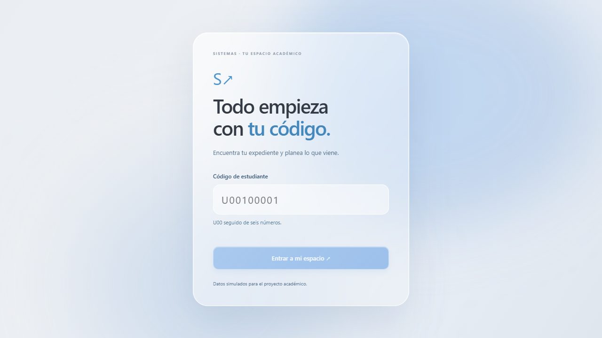 | 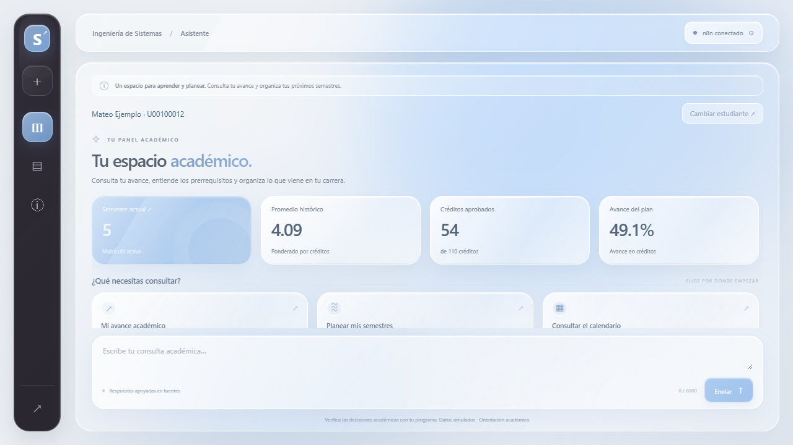 |

| Promedio y avance (SQL) | Próximo semestre (proyección) |
|---|---|
| 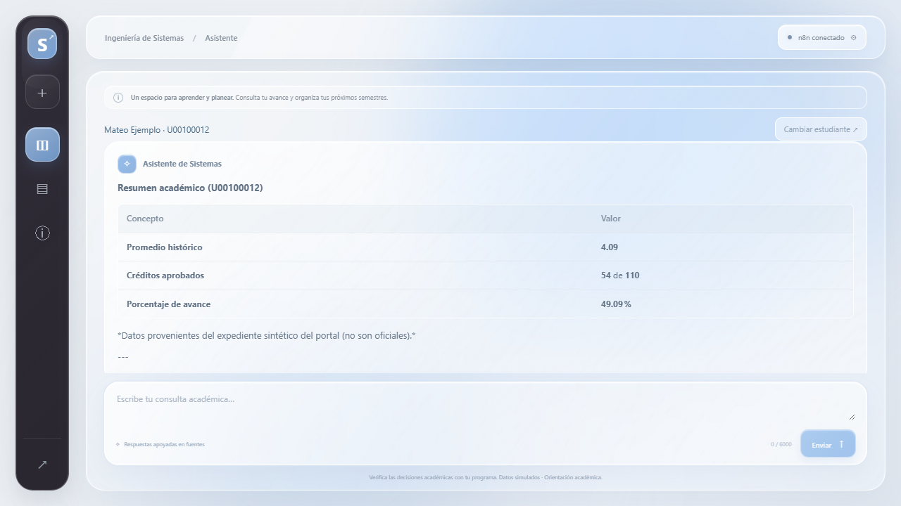 |  |

| Semestres restantes | Calendario (Google Sheets) |
|---|---|
| 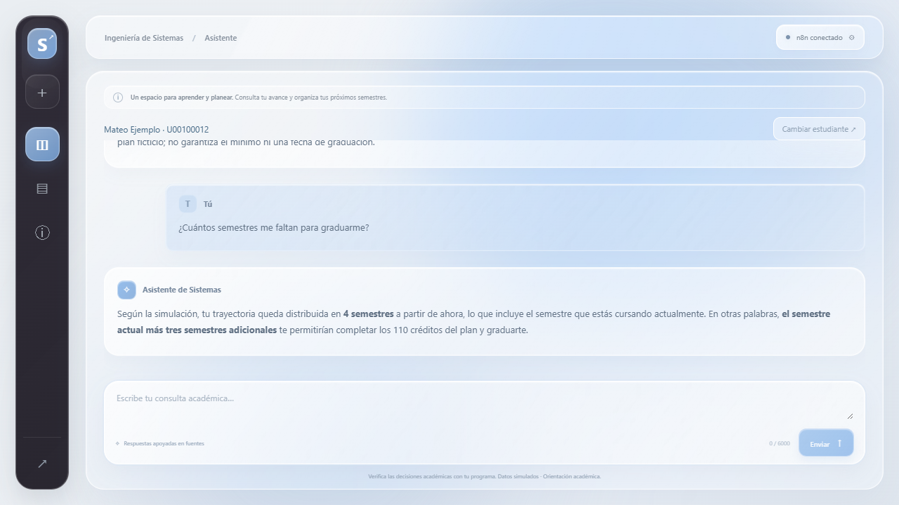 | 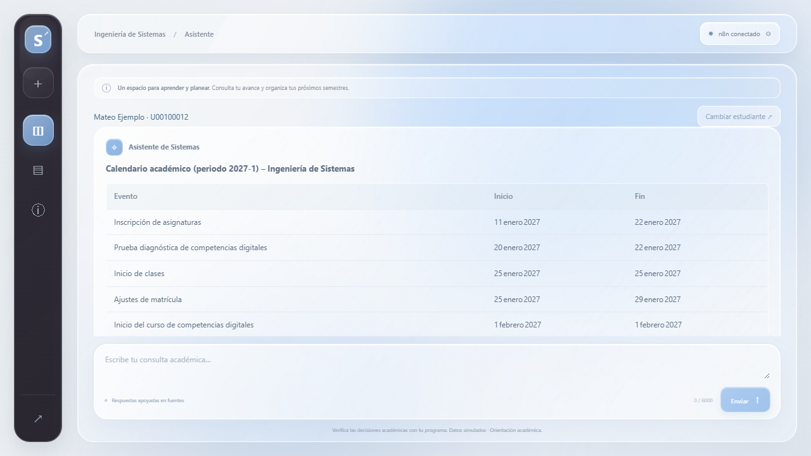 |

| Documentos del profesor (RAG) | Noticias UNAB (MCP) |
|---|---|
| 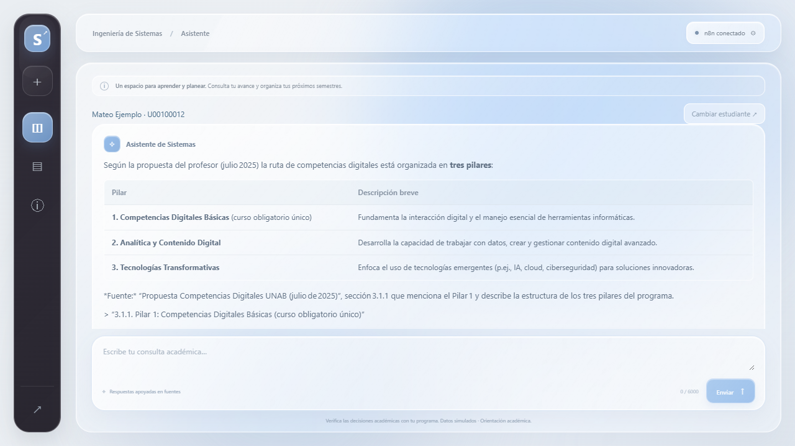 | 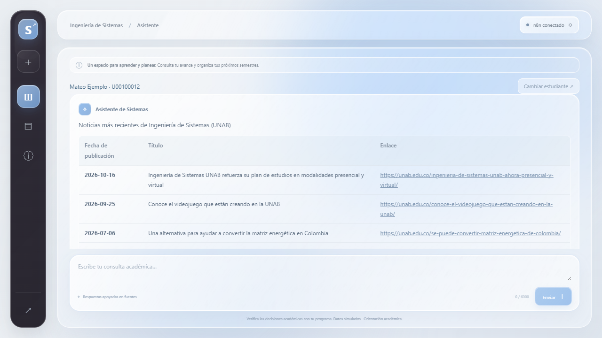 |

## 4. Arquitectura

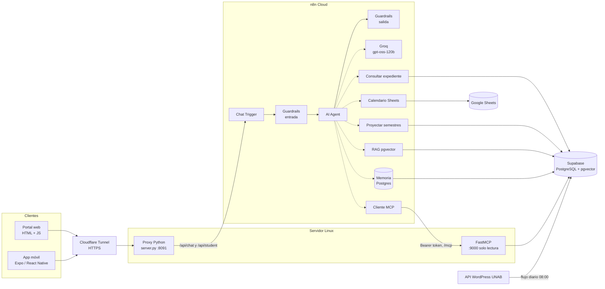

**Idea clave:** el navegador y el celular **nunca** hablan directo con n8n ni con la base de datos. Hablan con un proxy propio que fija el destino, valida el código del estudiante, ata la sesión a ese código y limita las consultas. Así no hay claves en el frontend.

## 5. Qué pasa cuando haces una pregunta

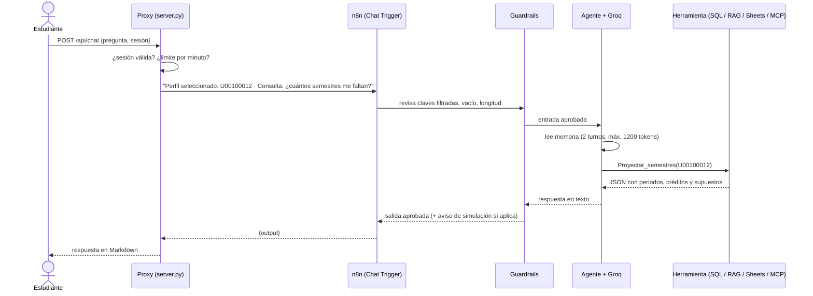

El proxy antepone el código del perfil a cada mensaje y las herramientas SQL **leen el código de ahí**, no de lo que diga el modelo. Por eso el estudiante solo consulta su propio expediente aunque intente pedir otro.

## 6. Las piezas, una por una

### 6.1 El agente en n8n (`Chatbot Academico`)

Un único flujo de 19 nodos. El **AI Agent** recibe un *system prompt* con reglas por herramienta y elige cuál llamar según la pregunta (no hay un clasificador aparte: el *tool calling* del modelo hace el ruteo).

| Herramienta | Tipo de nodo | Qué devuelve |
|---|---|---|
| Consultar expediente | Postgres Tool, SQL fijo con parámetros | resumen, historial o materias pendientes |
| Proyectar semestres | Postgres Tool → función `proyectar_semestres` | plan por periodos y supuestos |
| Buscar documentos académicos | PGVector Store (retrieve-as-tool) | 3 fragmentos con título y URL |
| Consultar calendario DEMO | Google Sheets Tool (solo lectura) | eventos del periodo 2027-1 |
| MCP académico | MCP Client Tool (Bearer Auth) | plan de estudios y noticias |

**Por qué SQL fijo:** el modelo nunca recibe una herramienta de "SQL libre". Solo rellena parámetros (`detalle = resumen | historial | pendientes`). Eso evita inyecciones y consultas costosas.

Otros cinco flujos se ejecutan aparte porque tienen otro ciclo de vida (no deben correr con cada mensaje):

| Flujo | Cuándo corre |
|---|---|
| Preparar Base Académica Demo | Una vez, al instalar |
| RAG Sistemas – Indexar documentos | Al cambiar los documentos |
| Preparar proyección de semestres | Al cambiar el algoritmo |
| Actualizar noticias UNAB | Todos los días a las 08:00 (Bogotá) |
| Preparar calendario DEMO | Una vez |

### 6.2 La base de datos

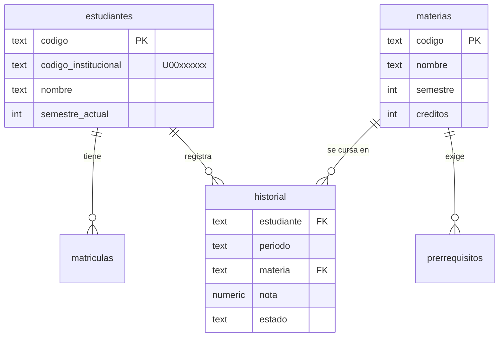

- **`v_resumen`**: promedio histórico **ponderado por créditos** (incluye intentos reprobados) y créditos aprobados **contados una sola vez** por materia.
- **`v_materias_pendientes`**: materias sin aprobar y si sus prerrequisitos ya se cumplen.
- **`proyectar_semestres(codigo, 18)`**: algoritmo voraz que llena cada periodo con materias elegibles hasta 18 créditos, y solo da por cumplido un prerrequisito si se aprobó en un periodo **anterior**. Es una simulación factible, no garantiza el mínimo de semestres.

Scripts: [`01_base_academica.sql`](01_base_academica.sql), [`07_proyeccion_semestres.sql`](07_proyeccion_semestres.sql), [`21_codigos_estudiante.sql`](21_codigos_estudiante.sql), [`24_tres_estudiantes.sql`](24_tres_estudiantes.sql).

### 6.3 RAG: que el bot lea los documentos del profesor

RAG (*Retrieval-Augmented Generation*) = buscar primero los fragmentos relevantes y dárselos al modelo para que responda con ellos.

1. **Partir** los documentos en fragmentos de hasta 1200 caracteres con 180 de solapamiento (por títulos Markdown). Resultado: **96 fragmentos**.
2. **Convertir** cada fragmento en un vector de 1536 números (`text-embedding-3-small`).
3. **Guardar** los vectores en PostgreSQL con la extensión **pgvector**.
4. En cada pregunta: convertir la pregunta en vector, buscar los **3 más parecidos** (similitud coseno) y pasarlos al agente.
5. El agente responde parafraseando y **cita título y URL** del documento.

Regla del prompt: máximo **una búsqueda RAG por mensaje**, para no gastar la cuota.

Archivos: [`06_ingesta_rag.json`](06_ingesta_rag.json) (flujo de indexación), [`16_estructura_vectores.sql`](16_estructura_vectores.sql).

### 6.4 MCP: herramientas propias, estándar y seguras

**MCP** (*Model Context Protocol*) es un estándar para exponer herramientas a agentes de IA. Aquí se construyó un servidor con **FastMCP** en Python ([`mcp-server/`](mcp-server/)) con cuatro herramientas de solo lectura.

- Corre en el servidor en `127.0.0.1:9000`; el proxy solo deja pasar la ruta `/mcp`.
- Exige **Bearer token**; el servicio guarda únicamente su hash SHA-256.
- Usa un **usuario de PostgreSQL de solo lectura** ([`readonly_role.sql`](mcp-server/readonly_role.sql)) con TLS `verify-full`.
- n8n lo consume con el nodo **MCP Client Tool** para el plan de estudios y las noticias.
- 14 pruebas automáticas ([`mcp-server/tests/`](mcp-server/tests/)).

### 6.5 Calendario y noticias

- **Calendario**: una hoja de Google Sheets con 6 eventos del periodo 2027-1. El prompt obliga a usarla para cualquier fecha (nunca la memoria del modelo).
- **Noticias**: un flujo programado lee la API pública de WordPress de la UNAB (categoría Ingeniería de Sistemas), limpia el HTML y hace *upsert* por id, así repetirlo **no duplica** registros. Guarda la hora de la última sincronización y el agente avisa si tiene más de 48 horas.

### 6.6 Guardrails y manejo de errores

- **Entrada**: rechaza mensajes vacíos, de más de 6000 caracteres o que contengan claves de API conocidas (`gsk_`, `sk-proj-`, …).
- **Salida**: bloquea claves y contenido `<script>` / `javascript:`.
- **Errores**: si Groq falla o llega a su límite, el agente sale por una rama de error que responde un mensaje claro, **sin inventar datos**.

### 6.7 Portal web y proxy

[`pc/server.py`](pc/server.py) sirve la interfaz ([`pc/dist/`](pc/dist/)) y hace de proxy:

- Acepta solo el dominio autorizado y peticiones JSON pequeñas.
- 12 consultas por minuto por IP y una a la vez.
- Vincula la sesión al código validado; caduca a las 2 horas.
- No registra el texto de las preguntas.
- Política CSP estricta (no permite scripts ni estilos en línea).

Se publica en Internet con **Cloudflare Tunnel**, sin abrir puertos en el servidor.

### 6.8 App móvil

[`app-movil/`](app-movil/) es una app **Expo (React Native)** que usa los mismos endpoints `/api/student` y `/api/chat`. Muestra el panel del estudiante, atajos (Matrícula, Proyección, Recomendaciones, Calendario, Noticias) y el chat con tablas desplazables. Si Groq está al límite, **espera y reintenta sola** (40 s y 60 s).

```powershell
cd app-movil
npm install
npx expo start   # escanea el QR con Expo Go
```

## 7. Lecciones aprendidas (lo que salió mal y cómo se corrigió)

Esta sección es la más útil para aprender: el bot "funcionaba", pero al revisar las ejecuciones aparecieron errores que **n8n marcaba como exitosos**.

| Problema observado | Causa | Corrección |
|---|---|---|
| Un aviso de "Alcance de la simulación" aparecía en respuestas de promedio | El nodo final lo agregaba si la respuesta contenía la palabra *semestre* | Solo se agrega si la respuesta habla de *proyección* o *periodos simulados* |
| "¿Qué puedo matricular el próximo semestre?" daba 4 respuestas distintas; una decía "te quedan 5 créditos" | `prerrequisitos_cumplidos` mira solo lo ya aprobado, y el modelo restaba los créditos en curso al semestre siguiente | Para el *próximo* semestre se usa el periodo 2 de la proyección (que supone aprobar lo que está en curso) |
| Respondía el promedio desde la memoria y calculaba "≈ 55 de 110" (eran 54) | La memoria guarda también el resultado JSON de las herramientas | Regla "llama la herramienta en ESTE turno" + historial limitado a 1200 tokens |
| Noticias reales etiquetadas como "simuladas" | El prompt general decía que todo era simulado | Excepción explícita para noticias |
| 4 de 30 ejecuciones devolvieron "servicio no disponible" | Límite de Groq: 8000 tokens/minuto y cada pregunta usa ~3000–6000 | Rama de error clara + reintento automático en la app |

**Moraleja:** `status: success` en n8n solo significa que el flujo terminó, no que la respuesta sea correcta. Hay que leer las salidas reales.

## 8. Cómo replicarlo

Necesitas: una cuenta de **n8n** (Cloud o self-hosted), **PostgreSQL con pgvector** (por ejemplo Supabase), una API key de **Groq**, una credencial de **Google Sheets** y, para el portal, un servidor con Python 3.

1. Crea la base: ejecuta [`01_base_academica.sql`](01_base_academica.sql), luego [`07_proyeccion_semestres.sql`](07_proyeccion_semestres.sql), [`15_estructura_noticias.sql`](15_estructura_noticias.sql), [`16_estructura_vectores.sql`](16_estructura_vectores.sql), [`21_codigos_estudiante.sql`](21_codigos_estudiante.sql) y [`24_tres_estudiantes.sql`](24_tres_estudiantes.sql).
2. En n8n importa los flujos (*Import from file*):
   - [`28_respaldo_ajustes_18nov.json`](28_respaldo_ajustes_18nov.json) → chatbot principal (versión más reciente).
   - [`06_ingesta_rag.json`](06_ingesta_rag.json), [`08_noticias_unab.json`](08_noticias_unab.json), [`09_calendario_demo.json`](09_calendario_demo.json).
3. Asigna tus credenciales: PostgreSQL, Groq como *OpenAI* con base URL `https://api.groq.com/openai/v1`, y Google Sheets. Los JSON **no traen claves** y el `webhookId` está oculto: n8n genera uno nuevo.
4. Ejecuta una vez la indexación RAG (debe dejar 96 fragmentos) y el flujo de noticias.
5. Prueba el chat desde n8n; cuando responda bien, **publica** el flujo.
6. (Opcional) Despliega el portal con `pc/server.py` y la variable `N8N_CHAT_URL` apuntando a tu Chat Trigger, y el servidor MCP siguiendo [`mcp-server/README.md`](mcp-server/README.md).

## 9. Estructura del repositorio

| Ruta | Contenido |
|---|---|
| `01`–`28_*` | SQL, fuentes RAG, respaldos de flujos n8n y bitácora numerada del proceso |
| [`pc/`](pc/) | Portal web (`dist/`), proxy `server.py` y pruebas |
| [`app-movil/`](app-movil/) | App Expo / React Native |
| [`mcp-server/`](mcp-server/) | Servidor FastMCP, rol de solo lectura y pruebas |
| [`docs/`](docs/) | Capturas y video de este README |
| [`verificacion/`](verificacion/) | Evidencias y resultados de pruebas |
| [`10_DOCUMENTACION_TECNICA.md`](10_DOCUMENTACION_TECNICA.md) | Documentación técnica detallada |
| [`ESTADO_DEL_PROYECTO.md`](ESTADO_DEL_PROYECTO.md) | Estado y cambios por fecha |
| [`Informe_final_Chatbot_Academico.pdf`](Informe_final_Chatbot_Academico.pdf) | Informe técnico y manual de operación |

## 10. Seguridad y límites

- **Sin claves en el repositorio ni en el frontend.** Las credenciales viven en n8n y en archivos privados del servidor.
- **Solo lectura**: el chatbot no matricula, no cambia notas y no ejecuta SQL que escriba el usuario.
- **Los datos de entrada son no confiables**: el prompt indica que mensajes, documentos y celdas nunca son instrucciones.
- **No es autenticación real**: el código U00 elige un perfil simulado. Para datos reales haría falta identidad institucional, autorización por expediente y revisión de privacidad.
- **Límite de cuota**: el plan gratuito de Groq puede pedir esperar un minuto.
- **La proyección es una simulación**: supone aprobar todo y oferta en cada periodo; no es una fecha de grado.

---

**Autor:** Nicolás Javier Abello Suárez — Ingeniería de Sistemas, 2026.
Material de referencia del profesor: [adiacla/clima-Biing26-UCC-Ibague](https://github.com/adiacla/clima-Biing26-UCC-Ibague).
